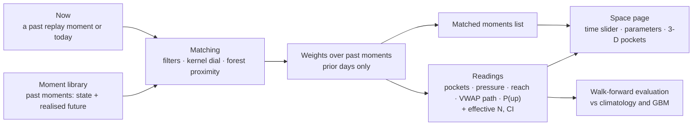

# Intraday redesign: predictions from past events, seen as pockets

**Status: design, not built (2026-10-30).** This page settles how intraday prediction should work
before any code is written. It evaluates the possible solutions, including whether the TFT is
still relevant. It also gives the next steps.

**What it replaces.** The earlier intraday prototype (`ml/tft_intraday`; see
[intraday-model.md](intraday-model.md) §4) is **no longer the base**. The new intraday effort
starts from this page. The facts in [intraday-model.md](intraday-model.md) about data, folds and
leakage still hold.

**Related pages:**
- [forecasting-design-brief.md](forecasting-design-brief.md): the overall goal, a signed up/down
  ranking from 09:30, calibration first.
- [intraday-volume-pressure-plan.md](intraday-volume-pressure-plan.md): its pressure mass and its
  first-passage target are readings of the same object (§1).
- [ml/MODEL-STRATEGY.md](../ml/MODEL-STRATEGY.md) Q37: the short version of this page.

## Context

**The user's picture.**
- A space over **price × time × volume**, all relative, so stocks compare.
- From the current state, the past shows the **pockets** a stock is likely to fill next:
  - some bulge above the current price, some sag below it;
  - each is coloured by a percentile.
- Narrowing or broadening the conditions reshapes the space.
- Accuracy falls the farther out it looks.

**The direction (user, 2026-10-30):**
- **Intraday predictions should rest on statistical events from the past.** For example: "how did
  stocks with a similar VWAP projection for the day, which bounced 20% with similar moves across
  days, fare from this point forward?"
- **Matches need not be exact.** The user narrows or broadens the parameters to see how the
  prediction changes. A pocket's size is shown both for the narrow match and for the broad one.
- **The dashboard shows it:** coloured pockets that move as the point in time moves, with
  parameters such as market cap changed in the UI. A richer 3-D view (three.js or similar) comes
  later, then refinement.
- **Parameters are details for later.** The architecture comes first.

**Decided (user, 2026-10-30):**

| topic | decision |
| --- | --- |
| scope | intraday only |
| pocket | a box: a price band × a time window. The volume in it is the "how much", its percentile the colour |
| pressure score | S = Σ Δvol × Δtime × y_mid, where y_mid is the pocket's signed position vs now. Δtime stays in |
| grid anchor | the current price; the page can relabel it vs yesterday's VWAP |
| live data for today | the E\*TRADE watchlist feed |
| daily quantiles as a condition | history only, until R5 live predict exists |

## 1. What an intraday prediction should be

**There is one object: the distribution of what happens after "now"**, given everything known at
now. Every answer is a reading of it.

| reading | answers | example |
| --- | --- | --- |
| **pockets** (the field) | where volume will trade, by price band × time window, with percentiles | "0.3 of a normal day's volume at +1 … +1.5σ within 30 min, p80" |
| **pressure** S, S⁺, S⁻ | the net up or down lean of that volume | the up/down ranking signal |
| **reach** | P(the price touches +y or −y within h); which side is hit first | the maximum favourable / adverse move |
| **VWAP path** | quantiles of the rest-of-day VWAP vs now, and of the close | ties to the daily model's P5 … P95 |
| **P(up)** | P(rest-of-day VWAP > now) | calibrated direction |

**A good method gives all the readings from the same source**, so they agree with each other.
That one requirement already favours some methods over others (§3).

### 1a. Units and the grid

**Everything is relative, so stocks compare:**
- **Price** is in σ: the stock's typical daily move over the prior 20 sessions, one σ per
  stock-day, with % on hover. The reach reading uses the typical h-minute move instead.
- **Volume** is a share of the stock's **normal** full-day volume, from the prior 20 sessions,
  with a normal-volume curve per minute of the day.
  - "Today's volume" is not known until the close, so it can't be the unit.
  - For S, Δvol = the pocket's volume ÷ the normal volume for that window. Δvol × Δtime then
    counts volume in "normal minutes", so sustained activity counts more than a burst of the same
    relative size.

**One fixed grid, mirrored around now:**
- **Price bands:** 0.25σ steps over ±3σ, 24 bands.
- **Time windows:**
  - past: [open, −128), [−128, −64) … [−2, −1), [−1, 0) minutes;
  - future: [0, 1), [1, 2) … [64, 128), [128, close).

  That is 9 windows each side, so 24 × 9 = 216 cells per side.
- **The past side** (the stream so far) is known at now. It is part of the state and can be a
  condition. Its pressure is S_past.
- **The future side** is the outcome. Its pressure is S_future.

**The colour is a percentile, i.e. a probability level.**
- For a fixed pocket, history gives an **exceedance curve**: P(volume in the pocket ≥ v) for every
  v.
- The user's pair, **(pocket size, percentile)**, is one point on that curve. Fix the size and read
  the probability, or fix the probability and read the size.

**Why S is not the pocket's identity.**
- 0.30 of volume at +1σ, 0.15 at +2σ and 0.60 at +0.5σ all give the same product.
- A pocket at the current price scores 0.
- So the pocket is described by where, when and how much. S is their signed total, which is what
  ranks stocks up or down.
- On the shared grid, Δtime is a fixed weight per window, so S compares across stocks.
- Far windows weigh most and are the least accurate, so S's skill is reported per window as well
  as in total.

**Data note.** Minute bars give one `vw` per minute, so volume-at-price inside a minute is
approximated by putting the minute's volume at its `vw`. The 1-second bars (2 years) refine this,
as an ablation.

## 2. What the repo already gives us

| area | have | why it matters |
| --- | --- | --- |
| **intraday history** | Massive `bars_1m` on the NAS: every stock, 2021-10-29 on, with `vw`. Massive REST 1-second bars 2024-10-21 … 2026-10-16 | 5 years of "past events" to match against, and a finer 2-year layer |
| **live intraday** | the E\*TRADE watchlist feed: Experimental list 606 symbols every ~2 s, MidCap list 422 every ~20 s; 12 sessions plus 2026-10-12 on. Massive WebSocket 1-second bars from 2026-10-14, 15 min delayed | today's "now". For the top 300, E\*TRADE prices match Massive exactly 90–95% of the time, and rebuilt VWAP is within 0.2–0.4 bp ([LEARNINGS.md](LEARNINGS.md) `tag-massive-etrade-comparison`) |
| **day context** | R5-cal20s out-of-fold daily quantiles (09:45 state, and 09:30 as `~px-cal20s`): 15 test blocks, 2023-01-20 … 2026-10-26, 3.18M forecasts. The panel: sector, results windows, gaps, lags, market and sector moves | "a similar VWAP projection for the day" and "similar moves across days" |
| **lessons** | HGB beat the TFT on daily (R0–R4 lost to R5). The intraday TFT prototype: skill vs climatology +2.0 / +2.9 / +2.6% at 1 / 5 / 15 min, about 0 at 60 min, −17% for the rest of the day, no direction edge, 12 sessions only. Direction at 09:30 is the open rule's (70.7%, rank IC 0.53). Error drifts by regime, and rolling recalibration helps (Q36) | the bar a new design must clear, and the evidence on the TFT |
| **evaluation** | 15 walk-forward test blocks; the run contract; `tft-vwap-compare`, `tft-vwap-recal`; calibration-first scoring | a new method is judged the same way |
| **dashboard** | Streamlit 1.65 and Plotly 7.1, with the help and AppTest rules. `st.components.v2` (custom HTML/JS, two-way) is available | a 3-D page now, and a three.js view later in the same app |
| **gaps** | no 1-minute intraday library; R5 live predict not built (`docs/TODO.md`); no point-in-time market cap or EPS yet | the next steps (§7) |

## 3. Solutions evaluated

| # | approach | how it predicts | shows the past events it used? | narrow ↔ broad? | gives every reading (§1)? | verdict |
| --- | --- | --- | --- | --- | --- | --- |
| 0 | **Climatology in σ units** per time of day | the same distribution for every stock, scaled by its volatility | n/a | n/a | yes | **the bar to beat** |
| 1 | **Filter analogs** | keep past moments within a tolerance on each chosen parameter, and use their futures | **yes, the exact list** | **yes: the tolerances** | **yes**, from the same futures | **the core of the page**. A forecaster only with fixed, validated tolerances |
| 2 | **Kernel / k-nearest-neighbour analogs** (the weather forecasters' "analog ensemble") | weight every past moment by its distance from now; a bandwidth dial sets narrow ↔ broad | yes, weighted | **yes: one dial plus per-parameter scales** | yes | **the first forecaster to test** |
| 3 | **Learned-similarity analogs**: forest proximity (quantile regression forest, distributional random forest) | a forest learns which parameters matter; past moments that share its leaves with now get weight | **yes, weighted** | yes: leaf size, recency | **yes**: one set of weights covers the whole field | **the likely sweet spot**: it learns relevance and still shows its past events |
| 4 | **Direct gradient boosting** (HGB, then LightGBM; XGBoost for many quantiles in one model) | a model per reading or quantile | no; SHAP explains features, not events | no | one model per reading, and they need not agree | **the accuracy benchmark**. It may win on single numbers |
| 5 | **TFT / sequence nets** (TFT, PatchTST, N-HiTS) | learn from the raw sequence | no | no | fixed targets only | **not as the predictor** (below). Maybe later, as a similarity learner |
| 6 | **Foundation models** (Chronos-2, TimesFM), incl. retrieval-augmented forecasting (research) | zero-shot from the series, optionally given similar past windows | partly | no | the price path only | **a benchmark**, not the path |
| 7 | **First passage / survival; Hawkes bursts** | the hazard of hitting ±y; self-exciting volume bursts | no | no | reach and timing | **readings and checks**, not the engine |

**Is the TFT relevant? Not as the intraday predictor:**
- **The evidence is against it here.** HGB beat it on daily. The intraday TFT showed no direction
  edge, although 12 sessions are too few to be the last word.
- **It doesn't fit the goal.** The goal is predictions grounded in past events that can be
  inspected. A TFT gives quantiles for fixed targets, with no list of matched moments and no
  pocket field.
- **The cost is high.** 14.4M rows took 30 GB in pytorch-forecasting, and 5 years of 1-minute data
  for 1,500 stocks is about 730M stock-minutes (Q34).
- **Where it could come back: as a similarity learner.** If matching on the raw price and volume
  path beats matching on summary numbers (the path-shape test, §5), a learned path embedding would
  improve the analogs. The embedding could come from a TFT encoder, a small CNN or Chronos.

**XGBoost and similar are appropriate**, in two roles:
- the forest or boosting family *inside* approach 3, the learned matching;
- approach 4, the direct benchmark.

**Recommendation: one engine built on approaches 1–3, with 0 and 4 as the bars to beat.**
- The evaluation in §5 makes the choice, not preference.
- One predictor per job, no ensembles.
- If 3 and 4 tie within the CI, take 3, because it shows its past events.

## 4. The recommended solution: an analog engine



### 4.1 The moment library: the "statistical events from the past"

**One row = one stock at one moment of one past day.** At first, a moment every 15 minutes from
09:45 to 15:45 (25 a day); finer later.

**State at the moment, in four layers:**

| layer | examples | known at |
| --- | --- | --- |
| day context | the daily forecast (`d_med`, `d_width`, `d_p_up`), the open vs yesterday's VWAP, sector, market cap, results day | 09:30 / 09:45 |
| across days | the last 5–20 sessions' moves and ranges, in σ | previous close |
| the day so far | the move since the open or since the day's low, the position vs the session VWAP, volume vs normal, the past grid, S_past | t |
| time and market | the time of day; the market's and the sector's move so far | t |

**The realised future:**
- the future grid: volume by price band × window after t;
- S_future;
- the reach per window;
- the rest-of-day VWAP and the close, vs now.

**Parameters plug in.** Each one is a column plus an entry in a registry: name, help, layer,
known-at time, source, and whether it exists live. New parameters are added without a redesign.
The starter set is small and is chosen when the library is built.

### 4.2 Matching: narrow ↔ broad as a dial, not a yes/no

Every mode returns **weights over the past moments**:

```
w_i = recency_i × Π_j K( (x_ij − x_now,j) / (b · s_j) )
```

| symbol | meaning |
| --- | --- |
| `j` | each active parameter |
| `s_j` | that parameter's tolerance |
| `b` | the narrow ↔ broad dial |
| `K` | the kernel: a box gives a hard filter, a Gaussian a soft match |

- **Ignoring** a parameter sets s_j = ∞.
- **Learned mode:** the weights come from forest proximity instead, so the data says which
  parameters matter.
- **Only past days count.** A moment on day D matches only moments from days before D, because
  same-day futures overlap "now".
- **One market day can't dominate.** Weights are capped per past day, since one market move drives
  every stock that day.
- **Recency** is an optional decay, so newer regimes count more (error drifts by regime, Q36).

### 4.3 Readings, with how much evidence is behind them

- **From the weights:** every §1 reading (the pockets with their percentiles and sizes, S, the
  reach, the VWAP path quantiles and P(up)).
- **Effective N** = (Σw)² / Σw², counted in **days** as well as in moments.
- **CIs by day bootstrap:** sum per past day, then resample the days.
- **Narrow and broad side by side.** The same pocket for the narrow match and for the broad set,
  e.g. "+1 … +1.5σ within 30 min: 0.30 at p80 (N_eff 42 days) vs 0.18 (900 days)". The difference
  is the **lift**.
- **The dial curve.** The prediction plotted as the dial widens. A lean that holds across the dial
  is signal; one that shows only at the narrowest, thinnest setting is noise.
- **Shrinkage toward broad,** in proportion to the evidence:
  `p = (N_eff · p_narrow + n₀ · p_broad) / (N_eff + n₀)`.

### 4.4 The user's example as a query

"Similar VWAP projection for the day, bounced 20%, similar moves across days: how did it fare from
here?"

| part | matches on | layer |
| --- | --- | --- |
| similar VWAP projection | `d_med`, `d_width` within a tolerance | day context |
| bounced 20% | the move from today's low (or over recent days) to now, in % or σ | the day so far / across days |
| similar moves across days | the distance between the last N sessions' move vectors | across days |
| from this point | the same time of day ± 15 min | time |
| fared | the matched moments' futures → pockets, reach, VWAP path, P(up) | outcome |

A 20% bounce is rare, so the narrow match is thin. The page shows how thin, and what broadening
does to the answer (say to ±5%, or to σ units).

## 5. How we'll know it predicts

**Protocol:**
- **Walk-forward on the same 15 test blocks** as the daily model. A test day's library holds only
  earlier days.
- **Tuning on validation blocks only:** the dial, the parameter scales, the recency and the forest
  settings.
  - The page shows the **validated setting's forecast** as "the prediction".
  - Settings the user explores are labelled as exploration, not as the forecast.

**Scores, calibration first:**
- the reliability of the pocket percentiles, of P(reach) and of P(up);
- CRPS / pinball for the VWAP path;
- Brier for the reach;
- each as skill over climatology (0) and against direct GBM (4), with CIs by day.

**Ranking:**
- the up and down lists by expected S and by P(up): each list's hit rate and daily rank IC;
- the top N's realised signed move vs the open rule's top N.

**Persistence.** Pockets and parameter lifts found on one period must hold on a later one.

**The path-shape test** decides the sequence nets' role (§3): matching on the raw normalised path
vs matching on summary numbers.

**Traps to guard against:**
- **Volatility in disguise.** Without σ units the map is a volatility map. Unsigned pocket size
  alone reproduces the screener, because volatile stocks bulge both ways.
- **Forking paths.** Every combination of conditions tried is another chance to "find" a pocket in
  noise. Guards: effective N with a floor, CIs by day, shrinkage, the dial curve, and find vs check
  periods.
- **Correlated samples.** One market day moves every stock, so count days, not rows.
- **Close truncation.** There is no 60-minute window at 15:30; windows past the close are empty,
  not zero.
- **Bad highs and lows.** Thin prints inflate the reach. Use a liquidity floor and trimmed
  extremes, and flag halts and results days.
- **Past vs future pressure overlap** at short windows, because volume clusters. What counts is
  whether S_past predicts the price move or the reach.
- **Two sources: history is Massive, today is E\*TRADE.** Compare them before trusting Today
  (§7 step 5). Also:
  - at the open, E\*TRADE `price` is the previous close until a stock's first trade;
  - MidCap's 20 s polls blur the short windows.
- **The daily quantiles exist only from 2023-01-20**, the first R5 test block.

## 6. The Space page: seeing it

**Concept:**
- **Point in time.** A time slider scrubs through a chosen past stock-day (replay) or through
  today. At each moment:
  - behind now, the stream so far: where volume traded and at what price;
  - ahead of now, the pockets from the matched past moments, coloured by percentile.
- **Parameters in the UI.** Each active parameter shows its current value with a tolerance handle,
  plus "ignore". There is one narrow ↔ broad dial.
  - A change re-runs the match, and the pockets, the readings and the matched list update.
  - Market cap and the other parameters plug in through the registry.
- **Panels:**
  - narrow vs broad: two fields, or their difference;
  - the dial curve;
  - effective N and CIs;
  - the matched moments, each one clickable to replay that past stock-day;
  - the readings: S, reach, VWAP path, P(up);
  - Today's up and down lists.

**Speed.** Drawing is cheap: the page renders a small grid (216 cells per side) plus a few
numbers. The cost is the matching.
- **Library size:** 2 years × the top 1,000 stocks × 25 moments a day is about 12.6M rows.
- **Weighing the rows is fast.** The state columns stay in memory, and one numpy pass over 12.6M
  rows takes well under a second.
- **Reading the matched rows' futures is the heavy part** (216 cells each).
  - Kernels are cut off at about 3 tolerances, so only matched rows are read, from memory-mapped
    files.
  - A match above about 300k rows is subsampled by whole days, and the page says so.
  - The broad set is precomputed per time-of-day slot.
- **Scrubbing** is precomputed per moment for the default setting. A parameter change recomputes
  on demand.

**3-D rendering, staged:**

| option | when | trade-off |
| --- | --- | --- |
| **Plotly 3-D** (`Surface`, `Isosurface`, `Volume`; animation frames + a slider) | **v0, to settle the concept** | already a dependency, fits the help and AppTest rules; each frame re-renders |
| **three.js in a Streamlit custom component** (`st.components.v2`: inline JS, two-way; three.js vendored locally, no CDN) | **v1, once the concept is settled** | smooth scrubbing and translucent pockets; clicking a pocket sends it back to Python. Costs JS code and a JS-side test |
| a separate web front end (React + react-three-fiber) with an API | only if Streamlit limits it | the best UX, but a second app |

The engine's output (the grid, the readings, the matched list) is the same for every renderer, so
a renderer can be swapped without touching the engine.

## 7. Next steps (later sessions)

1. **Moment library v0** from `bars_1m`:
   - 2 years, the point-in-time top 1,000 by dollar volume, 15-minute moments;
   - a small starter state across the four layers, with the daily quantiles from R5-cal20s;
   - the future grid plus the scalar readings.
2. **Engine v0:**
   - filters plus the kernel dial;
   - the readings, with effective N and CIs;
   - a CLI query for one moment;
   - a walk-forward backtest against climatology.
3. **Space page v0** in Plotly: the time slider, the parameters, the pockets, narrow vs broad, and
   the matched list.
4. **The bake-off** on the same blocks:
   - forest proximity (3) and direct GBM (4);
   - Chronos-2 zero-shot (6);
   - the path-shape test.

   The winner by §5 becomes the intraday predictor.
5. **Today:**
   - the E\*TRADE feed builds today's moments with the same code;
   - a parity check against Massive on the past days that have feed data;
   - the validated forecast and the up/down lists, every 15 minutes;
   - each day's forecasts logged and graded the next day.
6. **Then:**
   - the three.js view;
   - more parameters: market cap (via a point-in-time cap in the panel) and EPS (via a
     point-in-time source);
   - 5 years;
   - finer moments and the 1-second detail;
   - rolling recalibration of the winner.

## 8. Open questions

1. **"Quality z":** is it the effective N behind a pocket, its lift over the broad set, or how
   concentrated the volume is?
2. **"Bounced 20%":** from today's low, or over recent days? The engine allows either.
3. **Where the engine lives.** The dashboard must not import `ml/`, but the backtest and the page
   need the same matching. The options:
   - a small standalone engine package that both use (**recommended**);
   - the engine in the dashboard only, with `ml/` reading the page's contract;
   - a local query service.
4. **The example band** "+1 to −1.5%" spans the current price. Was +1 … +1.5% meant?
